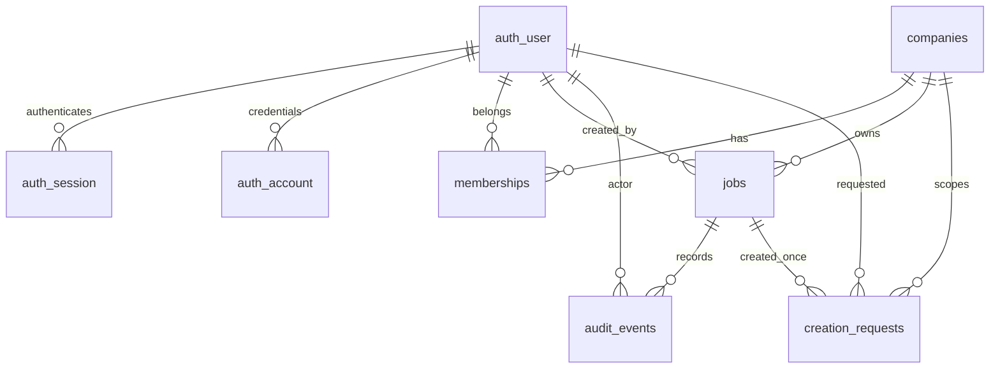

# 製品基盤の詳細設計・セキュリティレビュー

作成日: 2026-10-23。対象はP01〜P03（ログイン、会社所属、工事基本情報、操作履歴）。API・DB実装は親担当、UIは別担当。本書は設計とレビューのみであり、実装完了・公開可の宣言ではない。

レビュー時点の指摘を保存している。レビュー後の是正状況・実行した試験は [product-foundation-progress.md](product-foundation-progress.md) を参照。

参照: [要件](product-requirements.md)、[構成判断](product-architecture.md)、`server/`。レビュー中にも並行実装が進行しているため、以下の行番号は観測時点の位置。未実装の設計判断と、コードで確認した事実を区別する。

## 1. 優先修正事項

P1は基盤の受入を止める問題、P2は接続試験・運用前に解消する問題。本番公開は第8節の別ゲートで判断する。

| 優先度 | 観測箇所・事実 | 影響と対応 |
| --- | --- | --- |
| P1・修正後検証待ち | 旧`server/app.ts:17`の所属確認は`FOR SHARE`、旧`server/migrate.ts:26`では所属にSELECTのみ付与 | 実DBで42501発生と親担当から報告あり。最終確認では`002_membership_lock.sql`とAPIの関数呼出しへの変更を確認。所属の直接UPDATE権限は追加されていない。第3節の要件で修正後を検証する。[PostgreSQL 18 SELECT](https://www.postgresql.org/docs/18/sql-select.html) |
| P1 | `migrate.ts:27–28`は工事の直接INSERT/UPDATEと履歴の直接INSERTを許可。`001_foundation.sql:75–78`は履歴の操作者・所属・対象会社のみ検証 | 現行APIの工事・履歴書込は同一トランザクションだが、別の書込経路から履歴を省略できる。同じ操作者・会社・対象について、架空の変更前後・action・時刻を挿入することも防げない。DBトリガーで生成し、実行ロールの履歴INSERTを明示的にREVOKEする（第4節）。 |
| P1 | `manage.ts:20`の`signUpEmail`は会社・所属用BEGINより前。`auth.ts:17`は`autoSignIn:false` | 会社作成失敗で未所属アカウントが残る。既存メールに対してBetter Auth 1.7.12が返す合成ユーザーIDを、そのまま所属FKに利用する再実行経路がある。新規発行と既存アカウントの復旧を分け、再実行で別会社・別ユーザーを作らない（第3節）。[1.7.12公式ソース](https://github.com/better-auth/better-auth/blob/v1.7.12/packages/better-auth/src/api/routes/sign-up.ts) |
| P1 | `app.ts:147`の履歴取得は最新100件固定で継続取得手段なし | 101件目以降を参照できず、記録がないように見える。履歴ページングを追加し、最後まで到達する試験を必須とする。 |
| P2 | `db.ts:18–22`でROLLBACK失敗が原例外を置換し、接続を通常返却。`migrate.ts:35–36`でunlock失敗時はreleaseに到達しない | 接続状態が不明なまま再利用、または接続が返却されない経路がある。原例外を保ち、後始末失敗を別記録し、不健全な接続を破棄する。[node-postgres Pool](https://node-postgres.com/apis/pool) |
| P2 | `db.ts:27–32`の起動検査はjobsの所有権・superuser・BYPASSRLSのみ。`migrate.ts:23`は既存ロールを再検証せず、GRANTは旧権限を除去しない | 他の対象表の所有権、RLS無効化、余分なDML、特権ロールへのSET ROLE可能性を見逃す。第3節の権限実測を起動前ゲートにする。 |
| P2 | `app.ts:27`は本文にも型強制変換を適用。小規模検証では`name:123`が文字列、日付の空文字がnullとして200になった | 入力不備を黙って修正する。本文は型強制変換なしとし、日付未入力はUIがnullへ変換する。queryの数値変換とは分ける。[Fastify 5.12.x検証仕様](https://fastify.dev/docs/v5.12.x/Reference/Validation-and-Serialization/) |
| P2 | `app.ts:131`は409に「入力内容はまだ保存されていません」と固定表示 | 更新のcommit後に応答だけ失った再送でも409になる。前回保存の成否は不明であり、この断言は誤る。結果照合を伴う表示・再送に変更する（第6節）。 |

既存コードで確認できた防御は、Origin完全一致、認証用HTTPパスの許可リスト、公開signup無効、Cookieキャッシュ無効、同一接続での業務トランザクション、会社RLS、更新時の工事行ロック、作成キーの一意制約である。これらの存在と、実DB・ブラウザでの受入合格は別に扱う。

## 2. ERと責任境界

図の`auth_user/session/account`はBetter Auth管理の実表`"user"/session/account`を示す。`verification`と`"rateLimit"`も認証ライブラリのマイグレーション対象であり、独自のパスワード保存方式を追加しない。

| 表 | キー・不変条件 | 変更主体 |
| --- | --- | --- |
| companies | UUID PK、会社名1〜120文字 | 運営CLIのみ。初期APIに会社作成・変更・削除なし |
| memberships | `(company_id,user_id)` PK、roleはowner/manager/viewer、active | 運営CLIのみ。会社削除・退職で行を消さず、停止を明示 |
| jobs | UUID PK、所属先company_id不変、作成者不変、versionは1から単調増加 | 当該会社のactiveなowner/manager。初期APIにDELETEなし |
| audit_events | UUID PK、対象会社・工事・版・操作者・サーバー時刻・変更前後 | 工事変更のDBトリガーのみ（追加設計）。APIは閲覧のみ |
| creation_requests | `(company_id,user_id,request_key)` PK、正規化本文hash、job_id、初回response_data | 作成トランザクションのみ。実行ロールの更新・削除不可 |

追加するDB制約の設計判断:

- `jobs(company_id,id)`を一意にし、履歴の`(company_id,target_id)`、作成要求の`(company_id,job_id)`を複合FKで参照する。現在の独立したFKでは会社と工事の組合せを保証できない。特に`creation_requests`のINSERTポリシーは対象工事との会社一致を検証していない。
- 履歴に`target_version`と`request_id`を追加し、`(company_id,target_id,target_version)`を一意にする。作成はversion=1・before=null、更新は前版と次版を記録。版は対象工事内の順序を示し、サーバー時刻を全工事のcommit順序として扱わない。
- FKは削除連鎖なし。履歴のあるユーザー・工事を物理削除しない。退職者の表示名は現在の`user.name`では過去時点を再現できないため、履歴に当時の表示名を保存し、安定したactorIdを識別の基準とする。
- 日付はDATE、作成・更新・監査日時はTIMESTAMPTZ。JSONの日付は`YYYY-MM-DD`、日時はUTCのISO 8601。画面の日付入力をタイムゾーン変換しない。

信頼境界は、ブラウザ → 同一OriginのAPI → 制限されたDB接続 → 管理用接続の順。会社ID、userId、role、作成者、時刻、履歴本文をブラウザの申告だけで信頼しない。DBに設定する`app.user_id`は検証済みセッション由来に限定する。

RLSはAPIの会社条件漏れに対する防御であり、任意SQL実行やAPIサーバー侵害に対する独立した本人認証ではない。実行ロール自身は`app.user_id`を設定でき、現状は認証テーブルにも広いDML権限を持つ。この構成で「DB認証情報が漏れても会社分離が保たれる」とは主張しない。

既存IndexedDB試作は独立したまま保持する。製品入口で旧DBを読取・変換・送信・削除しない。P01〜P03の工事はサーバー保存だけを完了とする。撮影直後の端末保存・送信待ち・原本保存は次段階の必須要件であり、今回の工事登録完了を写真保存や契約成立に読み替えない。

## 3. 認証・所属・認可

### 3.1 権限表

| 操作 | 未認証 | 非所属・停止済み | viewer | manager | owner |
| --- | --- | --- | --- | --- | --- |
| `/api/me` | 401 | 有効な本人セッションなら200、active所属のみ返す | 200 | 200 | 200 |
| 当該会社の工事一覧・詳細 | 401 | 404 | 許可 | 許可 | 許可 |
| 当該会社の工事作成・更新 | 401 | 404 | 403 | 許可 | 許可 |
| 当該工事の操作履歴 | 401 | 404 | 403 | 許可 | 許可 |
| 利用者・会社・所属・役割の管理 | HTTP経路なし | HTTP経路なし | 不可 | 不可 | 不可 |

ownerも運営者ではない。初期段階のownerとmanagerの業務権限は同じ。viewerへの履歴非開示は現行RLSに合わせた設計判断であり、工事閲覧可から暗黙に履歴閲覧可へ拡張しない。所属のないアカウントでログインできても、会社データへの権限は生じない。

### 3.2 `lock_membership`の契約（親担当の修正方針）

1. 同一PoolClientでBEGINし、検証済みuserIdを`set_config('app.user_id', userId, true)`へ渡す。通常の業務SQLはこの接続だけで実行する。[node-postgres transactions](https://node-postgres.com/features/transactions)
2. `lock_membership(companyuuid)`は会社UUIDだけを受け取る。`SECURITY DEFINER`、固定の空`search_path`、テーブルの完全修飾、固定SQLとする。利用者IDを引数として受け取らない。
3. 関数内で`company_id = 引数 AND user_id = current_setting('app.user_id',true) AND active`を明示し、当該所属行を`FOR SHARE`でロックしてroleだけを返す。所有者権限でRLSを迂回し得るため、この明示条件をRLS任せにしない。未設定・空のuserIdでは行を返さない。
4. 関数のPUBLIC実行権限を同じマイグレーショントランザクション内でREVOKEし、runtimeだけにEXECUTEを付与。関数所有者へのSET ROLE、関数差替え、所属の直接UPDATEをruntimeに許可しない。[PostgreSQL 18 SECURITY DEFINER](https://www.postgresql.org/docs/18/sql-createfunction.html)
5. 該当なしは404。存在するviewerの変更・履歴操作は403。会社所属の判断を済ませてから冪等応答を返す。権限停止・降格後に過去の作成キーだけでデータを取り出せないようにする。

停止・役割変更は同じ所属行をUPDATEする。先行する書込の共有ロックが解放されるまで停止処理を待機させる。停止成功はそのUPDATEのcommit後にだけ報告する。これにより、停止が確定する前に許可された書込は先に完了し、停止確定後の新しい書込は拒否される。ロック待ちタイムアウトを停止成功と表示しない。[PostgreSQL 18行ロック](https://www.postgresql.org/docs/18/explicit-locking.html)

読取も毎回RLSを適用する。ただし停止前に取得済みの画面内容や送信中の応答を取り消す保証はない。工事詳細GETは現状`member()`を通さないため、この読取境界と書込の停止保証を混同しない。複数所属の停止・一括管理では会社IDとuserIdの一定順でロックし、デッドロックを避ける。

### 3.3 実行ロールと起動条件

- runtimeは非所有者・NOSUPERUSER・NOBYPASSRLS・NOCREATEROLE・NOCREATEDB。会社/所属はSELECTのみ、jobsは必要列のINSERT/UPDATEとSELECT、履歴はSELECTのみ、作成要求はSELECT/INSERTのみとする。認証表はBetter Authが必要とする権限を別途列挙し、業務ハンドラから汎用照会しない。
- 全業務表でRLSが有効なこと、実際のACL、関数所有者・定義・EXECUTE、特権ロールへのSET ROLE可能性を検査する。`NOINHERIT`だけを権限昇格防止の根拠にしない。PostgreSQL 18の`pg_has_role`はUSAGEとSETを区別する。[公式権限照会](https://www.postgresql.org/docs/18/functions-info.html)
- 権限を狭める移行では明示REVOKEが必要。既存GRANTの上に新GRANTを足すだけでは是正にならない。CREATE/TRIGGER/TRUNCATE、監査UPDATE/DELETE、所属更新、所有者ロール切替が実際に拒否されることをruntimeで試験する。
- 管理用資格情報をAPIプロセスに渡さない。現在の起動時`assertRuntimeRole`は上記の完全検査ではない。`FORCE ROW LEVEL SECURITY`の追加だけでもsuperuser/BYPASSRLS対策にはならず、所有者で動く限定関数への影響を検証する。[PostgreSQL 18 RLS](https://www.postgresql.org/docs/18/ddl-rowsecurity.html)

### 3.4 ログインと管理操作

- Better Auth 1.7.12を固定し、HTTPに接続するインスタンスは常に`disableSignUp:true`。`provisioning:true`は運営CLI内だけ。現在のHTTP許可リストはPOST sign-in/email、POST sign-out、GET get-session。管理・登録・メール変更・削除経路を追加するときは別レビューを行う。[公式メール/パスワード認証](https://better-auth.com/docs/authentication/email-password)
- DBセッションを用い、CookieはHttpOnly/SameSite、公開時Secure。cookieCacheは無効のまま。現設定は12時間の有効期間を1時間のupdateAge経過後に更新する方式で、ログインからの絶対12時間制限ではない。[公式セッション管理](https://better-auth.com/docs/concepts/session-management)
- POST/PATCH等はOriginの完全一致を要求し、未指定・null・複数値・別ポート・類似ホストを拒否する。ログイン/ログアウトにも適用。OriginはCSRF対策であり、認証・所属判定の代替ではない。
- サインイン制限は現在5回/60秒。`app.ts`は外部からの転送IPを破棄して`request.ip`を認証へ渡す。VPSのプロキシ経由では現在の設定だと接続元がプロキシIPに集約され得る。信頼するプロキシを限定し、入口で転送ヘッダーを上書きして、別利用者の巻き添え制限とIP偽装を試験する。[公式Rate Limit](https://better-auth.com/docs/concepts/rate-limit)
- 新規アカウント発行では、認証側の成功と会社・所属作成の成功を別状態として扱う。既存メールは自動的に新会社へ結び付けず、運営者が実在するuserIdと未所属状態を確認する明示的な復旧処理を用意する。並行発行も重複を拒否する。パスワードをコマンド引数、標準ログ、Gitへ出さない。
- manager/viewerの追加、会社単位の停止・降格、全社停止とセッション失効の管理手順が必要。現CLIの`migrate/provision`だけではP01の運用は完結しない。所属停止だけでパスワード認証自体まで無効になるとは扱わない。管理操作は運営者、対象、理由、変更前後、成否をアクセス制限された運用記録へ残す。

## 4. 操作履歴の信頼性

採用する設計判断は、工事変更からDBトリガーで履歴を生成する方式。アプリの明示INSERTは現状の同時commitを実現しているが、書込経路追加時の記録漏れをDBでは防げない。トリガー方式はマイグレーションと権限試験が増える代わりに、記録の必須化と実際の変更前後の採取を一箇所で強制できる。

1. jobsのINSERT時はversion=1、created_by=認証主体、作成・更新時刻=DB時刻をDB側でも強制する。UPDATE時はid/company_id/created_by/created_atを不変とし、versionはOLD+1だけを許可する。`updated_at`を任意のクライアント時刻にしない。
2. AFTER INSERT/UPDATEで、DBのOLD/NEWから許可済みフィールドを抽出し、action・target・target_version・actor・before/afterを構成する。APIからbefore/afterを引数として受け取る汎用監査関数は作らない。`OLD/NEW`はPostgreSQL 18の行トリガー仕様に従う。[公式トリガー仕様](https://www.postgresql.org/docs/18/plpgsql-trigger.html)
3. 監査関数は管理側所有者で実行する限定SECURITY DEFINERとし、固定search_path・完全修飾・PUBLIC実行REVOKEを適用する。runtimeには履歴INSERT/UPDATE/DELETE/TRUNCATE、トリガー解除を許可しない。実行主体が空、対象不整合、履歴書込失敗なら工事変更も失敗させる。
4. 工事、履歴、作成冪等記録は同一トランザクションでcommitする。監査失敗をcatchして工事だけ成功させる処理は禁止。同内容の明示更新も一つの版・履歴として記録する。再送判定で返す既存応答には新規履歴を作らない。
5. 履歴は当該会社のowner/managerのみ閲覧。認証情報、Cookie、パスワード、セッショントークンをbefore/afterに含めない。認証失敗・403・入力エラーは成立した工事変更ではなく、別の保護された運用ログへ記録する。

`request_id`はAPIが生成する追跡IDであり、本人性・否認防止の証明ではない。DB管理者による履歴改変、サーバー侵害、バックアップ巻戻しへの外部証明は今回の保証外。ハッシュ列だけを追加して改ざん不能と表示しない。履歴の訂正が必要な場合も既存履歴を上書きせず、管理された訂正記録を追加する方式を後続で決める。

## 5. APIとUIの接続契約

初期APIの現実装に合わせ、工事更新はPATCHでも6業務フィールド全てとversionを送る。部分更新・JSON Patchは受け付けない。以下の追加設計（エラーcode、履歴ページング等）は未実装分であり、UIとAPIを同時に合わせて受け入れる。

| API | 入力 | 成功応答・境界 |
| --- | --- | --- |
| GET `/api/me` | Cookie | `{user:{id,name,email},companies:[{id,name,role}]}`。active所属のみ。会社0件は200で管理者への連絡状態 |
| GET `/api/companies/:companyId/jobs` | offset=0、limit=50、省略可。limit最大100、offset最大100000 | `{jobs:Job[],total:number}`。createdAt DESC,id DESC。totalは現在数で固定スナップショット保証なし |
| POST 同上 | `Idempotency-Key: UUID`と6フィールド | 初回201、同一キー・本文再送200、いずれも`Job`。別本文の再使用409 |
| GET `/api/companies/:companyId/jobs/:jobId` | 会社・工事UUID | `Job`。別会社の工事IDを組み合わせても404 |
| PATCH 同上 | 6フィールドと現在の整数version | 次版の`Job`。他更新あり409。version未指定・不正400 |
| GET 同上`/audit` | 追加設計: limit既定50/最大100、cursor | `{events:AuditEvent[],nextCursor:string|null}`。工事版の降順、末尾まで取得可。現実装は`events`最新100件のみ |

`Job`は6フィールドに`id,companyId,version,createdBy,createdAt,updatedAt`を加える。`AuditEvent`は現行の`id,actorId,actorName,action,occurredAt,beforeData,afterData`に`targetVersion,requestId`を加える。レスポンスは許可リストで構成し、認証ライブラリのuser/session全体やSQLの`SELECT *`をそのまま公開しない。

| フィールド | 入力規則 |
| --- | --- |
| name / siteAddress / customerName / workDescription | 文字列のみ、trim後の非空。最大120 / 250 / 120 / 2000文字。HTMLとして描画しない |
| plannedStart / plannedEnd | 実在する`YYYY-MM-DD`またはnull。1900-01-01〜2199-12-31。両方ある場合だけ終了>=開始。これは現実装の入力範囲であり法定期間ではない |
| version | 整数1〜2147483646。文字列・浮動小数点・範囲外は拒否。DB整数の上限到達時は更新不可を明示 |
| companyId / jobId / Idempotency-Key | UUID検証後に小文字へ正規化。actor/会社所属/作成日時などの追加本文プロパティは拒否 |

本文はapplication/json、上限32KiB。unsupported media typeは415、過大入力413、不正JSON/フィールドは400。`normalizeJob`の不正日付によるRangeErrorを400へ変換し、HTTP検証を通らない呼出元でも同じ規則を保つ。本文の型強制変換を止めてもqueryのlimit/offset解析は維持する。

業務APIエラーは追加設計として`{code,message,requestId}`に統一する。主なcodeは`AUTH_REQUIRED`(401)、`FORBIDDEN`(403)、`NOT_FOUND`(404)、`VALIDATION_ERROR`(400)、`VERSION_CONFLICT`/`IDEMPOTENCY_KEY_REUSED`(409)、`RATE_LIMITED`(429)、`TEMPORARILY_UNAVAILABLE`(503)。予期しない実装エラーは500とし、全エラーを503に丸めて自動再送対象にしない。Better Authの応答形状は認証境界で別途扱い、messageの文面解析で分岐しない。

UIはログイン → 所属会社選択（1社なら自動）→ 工事一覧 → 基本情報のステップ入力 → 保存後の詳細を基本動線とする。編集中・送信中・サーバー保存済み・競合・結果不明を区別する。会社を切り替えた時点で古い取得要求を無効化し、遅れて届いた他社の応答で画面を置き換えない。未保存入力を別会社へ自動送信しない。

API・認証応答はno-store。製品用HTMLと機微データをService Worker等へキャッシュしない。ログアウトで製品画面の取得済みデータ・クエリキャッシュを破棄するが、独立した旧IndexedDB資産を一括消去しない。工事のステータスは契約成立、着工可、適法確認済みを意味しない。

## 6. 競合・失敗・再送

### 6.1 作成

1. UIは保存操作ごとにUUIDキーを一度生成し、同じ送信の再試行では会社・利用者・本文・キーを固定する。二重押下だけで新しいキーを作らない。
2. APIは型検証・正規化後、固定順の6フィールドのJSONをSHA-256でhash化する。現在の`normalizeJob`は固定順オブジェクトを返す。仕様変更でhash規則を変える際は過去キーの扱いも移行設計する。
3. トランザクション内で所属ロック・権限確認、冪等キー単位のロック、既存要求照合を順に行う。UUID大小文字の違いでロック対象とDBの一意キーがずれないよう、ロックにも正規化後の値を使う。
4. 一致なら初回応答を200で再現。不一致なら409。未登録なら工事作成、監査、作成要求を保存してcommit。PKを最終的な重複防御とし、同時要求でも工事・履歴は各1件にする。
5. 応答消失時は同じキー・本文で再送する。保存済み工事が後から更新されていても、再送では初回応答を返す。UIはその後GETで現在版を取得する。

`creation_requests`を期限未定のまま自動削除しない。削除後の古いキー再送は新規工事になり得る。初期は保持し、保存期限・容量方針を決める段階で再送受付期間と失効応答を同時設計する。再読み込みをまたぐ自動再送は今回未提供とし、旧IndexedDBをキューとして流用しない。結果不明のまま画面を閉じた場合は、再ログイン後に工事一覧を確認してから再作成する。

### 6.2 更新

同一トランザクションで所属ロック → 対象工事の`FOR UPDATE` → version比較 → 更新・監査 → commit。現在の行ロック後比較は同時更新を直列化する。UPDATEにも会社・工事・期待versionを条件として残し、返却0件を成功扱いにしない。未認可の行について競合情報を返さない。[PostgreSQL 18トランザクション分離](https://www.postgresql.org/docs/18/transaction-iso.html)

同じversionの二要求は片方だけ成功し、他方は409。後勝ち上書き、自動マージ、競合直後に最新versionへ置き換えた再送は禁止。UIは編集時の内容・送信内容・取得した最新版を保持して差分を示し、利用者が確認して再保存する。

更新応答が消えた場合は「結果不明」。旧versionで再送して409でも、前回の更新が成立した可能性がある。GETで現在版と送信内容を比較し、一致する場合は「現在の保存内容は入力と一致」と表示できるが、今回の要求が実行された証明とはしない。PATCH専用の冪等受領記録は今回追加しないため、この限界を受入条件に含める。

### 6.3 障害時の確定状態

| 失敗箇所 | サーバー側の扱い | UIの扱い |
| --- | --- | --- |
| 認証・Origin・権限・入力検証 | 業務書込なし | 401は再認証、403/404は操作停止、400は入力保持して修正 |
| 工事変更後、監査または冪等記録の失敗 | 全体ROLLBACK | 未確定。エラーを表示し同一要求で再試行 |
| deadlock・ロック/SQLタイムアウト | トランザクションを終了。既知のabortだけ限定再試行 | 回数制限付き再試行。429はRetry-Afterを尊重 |
| COMMIT中の接続断・COMMIT後の応答消失 | 成否を断定しない。応答が届かないだけでは取り消せない | 作成は同じキー、更新はGET照合。新規キーや新versionで盲目的に再送しない |
| ROLLBACK・接続後始末失敗 | 元エラーを保持し、接続破棄。履歴へ成功イベントを追加しない | 保存済み表示にしない |
| 所属停止・降格 | 再送時にも現権限で拒否 | 入力を自動送信せず、機微情報を画面に残し続けない |

DB待機・接続待ちには上限を設け、ロック中に外部通信・UI待ち・認証メール送信を行わない。無制限リトライは不可。フロントでの通信中断だけでDB処理も中断したとは扱わない。

## 7. 必要なテストと今回の検証範囲

実DB試験は親担当が実行する。本レビューではDB変更、API実装、UI実装、公開操作を行わない。以下は基盤受入に必要な観測結果であり、テスト関数名や未確認のテスト成功を捏造しない。

| ID | 試験 | 合格条件 |
| --- | --- | --- |
| T01 | 未認証、期限切れ・削除済みセッション、偽Cookie | 業務APIは401、DB障害は認証成功扱いにしない |
| T02 | HTTP公開signup、未許可auth経路、provisioning設定混入 | 登録・管理経路をHTTPから使用不可。新規アカウントなし |
| T03 | owner/manager/viewer、2社所属、非所属、停止済みの全API表 | 第3節の権限表と一致。URLの会社/工事組合せ入替でも漏えいなし |
| T04 | runtimeでRLS直結試験。WHEREの会社条件を省略、app.user_id未設定・空、poolでA→B→未設定 | 自社・有効権限分以外は読取/変更不可。接続間の主体残留なし |
| T05 | `lock_membership`をruntime・無権限ロールから直接実行。別利用者の所属、別会社、空主体、同名一時表を試す | 自分のactive所属だけ返す。PUBLIC実行不可、名前解決によるすり替え不可 |
| T06 | 所属停止/manager→viewerと更新を2接続で競合。停止待ちのタイムアウトも注入 | 停止成功後の変更なし。既存Cookie・同一作成キーでも権限復活なし |
| T07 | runtimeの履歴INSERT/UPDATE/DELETE/TRUNCATE、所属UPDATE、特権SET ROLE、トリガー解除 | 全て拒否。制限関数経由以外の権限昇格不可 |
| T08 | 工事変更だけを実行、履歴書込失敗、冪等記録失敗、トリガー例外 | 成功変更には履歴が必ず1件。途中失敗なら工事・履歴・要求記録が全て未確定 |
| T09 | 同versionで2接続更新、会社違いの同工事ID、no-op更新 | 一方だけ次版成功、他方409。履歴の前後が実際のDB版と一致 |
| T10 | 同キー同本文の同時作成、異本文、UUID大小文字、別利用者・別会社 | 同じスコープで工事/履歴各1件。異本文409。別スコープは独立 |
| T11 | commit直前/直後の切断、成功応答喪失、二重クリック | 作成再送で重複なし。更新の結果不明を誤って未保存/保存済みと断言しない |
| T12 | Origin欠落/null/異常値/別ポート、JSON以外、過大本文、型違い、未知フィールド、閏日・不正日付 | 契約通りの4xx。SQL・スタック・秘密値をレスポンスへ出さない |
| T13 | ロールバック失敗、unlock失敗、接続終了、停止シグナル | 原原因が追跡でき、接続が漏れず、不明な接続を再利用しない |
| T14 | CLI途中失敗、同じメール再実行、並行発行、全社停止 | 未所属アカウントを明示回復できる。意図しない別会社の所属を作らない |
| T15 | 履歴101件以上、同時刻、操作者改名・停止、ページ間の追加 | 古い履歴まで参照可能。重複/欠落なく対象版順に取得。当時の操作者表記を保持 |
| T16 | HTTPS・複数Set-Cookie・ログアウト・IP偽装・プロキシ経由制限 | Cookie属性維持、認証情報の漏えいなし、別利用者のIP分離、制限迂回なし |
| T17 | 実行ロールでの新規DB作成後と既存DB移行後、マイグレーション並行実行・中断再開 | 両経路で同じACL/RLS/関数。余分な権限が残らない。途中状態でAPIを起動しない |
| T18 | スマホ2端末・別ブラウザ・会社切替・401/409/通信断・ログアウト | サーバー共有と入力保持、古い応答の抑止、保存状態表示が一致。旧IndexedDBに変更なし |

今回実行した小規模検証（ファイル作成なし、Node 24.13.1）:

- `jobProperties`を使用したFastify 5.12.7のinject検証: 通常入力200、不正日付400。現APIと同じAjv設定では未知フィールド400、数値nameは文字列へ変換され200、空文字日付はnullへ変換され200。
- `normalizeJob`の直接呼出し: `2000-13-01`でHTTP用400ではなくRangeErrorになる。HTTPのdate検証では先に400となるため、現HTTP経路からの500発生とは断定しない。
- `transaction`へROLLBACKだけ失敗する模擬接続を渡した検証: 原例外がrollback-failureに置き換わり、通常releaseが呼ばれることを確認。
- 実DBのRLS・権限・監査原子性・並行更新は本レビューでは未実行。親の42501報告は確認情報として記載し、修正後合格とは扱わない。
- 最終静的確認で`002_membership_lock.sql`の空search_path、完全修飾所属表、自分のactive行限定、FOR SHARE、PUBLIC実行REVOKEと、`migrate.ts`のruntime向けEXECUTE付与、APIからの呼出しを確認した。関数所有者・他ロールの実効権限と並行失効の挙動は実DB試験で確認する。

## 8. リリースゲートと引継ぎ

| ゲート | 必須条件 | 現時点の扱い |
| --- | --- | --- |
| G1: 開発基盤の結合受入 | P1是正、T01〜T15/T17の実DBを含む合格、型検査、API/UIの応答契約一致、既存試作保持 | 未達。親のAPI/DB修正と試験結果で更新する |
| G2: 限定環境での運用検証 | G1、本人確認・発行/回復/停止・管理者保護、HTTPS/DB非公開/秘密分離、T16/T18、ログと監視、復元試験 | 未達。実案件投入・外部公開の許可ではない |
| G3: 製品公開 | G2と既存architectureの全公開条件。P04〜P08の移行・受入、写真即時保存/再送/原本、専門家レビュー、保存/削除・責任者・復旧目標の確定 | 今回の範囲外。P01〜P03完成だけで公開しない |

ConoHa VPSのOS・PostgreSQLメジャー/パッチ・ドメイン・容量・RPO/RTO・別保管先・費用上限は未確定。単一VPS内のDBとバックアップだけでホスト喪失への復旧を保証しない。既存資料の未決事項を、架空の本番設定や新規有料サービス導入で埋めない。

認証ライブラリのマイグレーションと業務マイグレーションは、現在の`migrate.ts`では単一の原子的処理ではない。実行中はAPIを停止し、両方の完了と権限検査後に起動する。適用済みSQLを書き換える運用ではなく、既存DBを対象にした追加マイグレーションで移行・復旧を検証する。SQLログにもCREATE ROLE等の秘密が残らない運用を確認する。

GitHubにはコード・設計・合成試験データのみ。実案件、DBダンプ、認証Cookie、環境変数、実写真は置かない。外部業務連携とスマホ以外の機器は追加しない。法令の閾値・保存年数・適法性は本書で新たに断言せず、契約・写真・支払の本番移行時に根拠と専門家レビューを揃える。

参照バージョン: ローカル実体はNode 24.13.1、Fastify 5.12.7、Better Auth 1.7.12、pg 8.23.1を確認。PostgreSQLの実稼働バージョンは本レビューでは不明で、SQL仕様の根拠は公式18文書を使用した。Better Authの一般文書は版固定ではないため、登録の重複応答は公式v1.7.12ソースおよび導入済みパッケージと照合した。採用DB版と依存更新時には同じ試験を再実施する。
